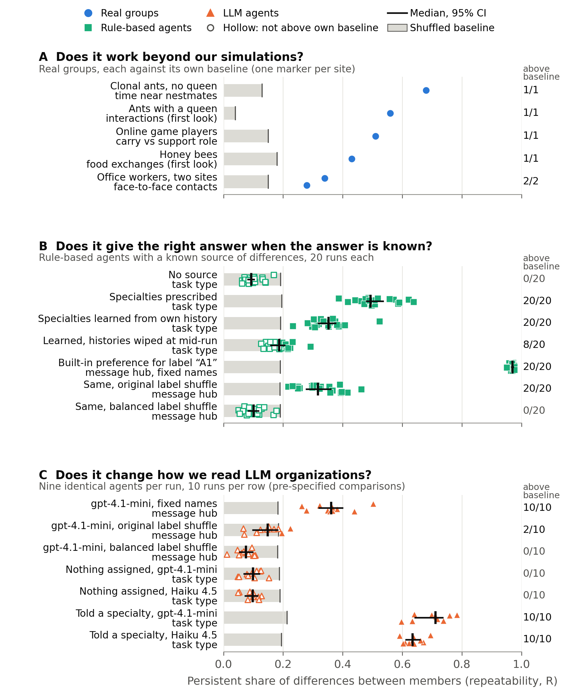

# An emergence audit for synthetic organizations

Research artifact for a Stage 1 proposal to the *Organization Science* special issue
"AI-Enabled Frontiers in Organizational Science". Authors are withheld for review.

**The question.** When a hub, a leader or a specialist appears among AI agents working
together, did the agents generate that structure, or did the researcher's prompt inject it?
This repository implements an emergence audit for suitably logged multi-agent simulations,
in three steps. *Detect*: do differences between members persist over time beyond a
shuffled baseline? *Stress-test*: does the structure survive shuffled labels, orderings and
exposure? *Attribute*: was it prescribed by the prompts, induced by the design, or generated
through interaction? The same code runs on real groups as reference cases.



*Figure 1. Markers are runs or sites, filled when above their own shuffled baseline (95th
percentile of a label-permutation null) and hollow when not. Grey bars run to each row's
median baseline; black marks show the median with a bootstrap 95% interval; the right column
counts runs above baseline. (A) Real groups. (B) Rule-based agents with known sources of
differentiation; for wiped histories, attribution rests on continuity across the wipe. (C)
The plan-specified comparisons of LLM organizations. Rows record different behaviors, so read
each value against its own baseline. Drawn by `code/figures/make_figure1_v4.py` from the stored
results.*

## Try it in one minute (no API key)

```bash
pip install -r requirements.txt
cd code
python3 audit_report.py --csv examples/example_log.csv
```

`examples/example_log.csv` holds three stored runs in the documented log format (run, time,
member, action, partner, task_type, optional opportunity); `audit_report.py --help` describes
it. The report scores four dimensions of differentiation (individual, functional, relational,
structural) against each run's own label-permutation baseline, summarizes them across runs
and lists the cross-run signatures; `examples/example_report.md` is its output. Point it at
your own log, or at any folder of stored runs:

```bash
python3 audit_report.py --specimens diffenv_results/balanced_2026-10-17/specimens
```

## What is here

| Part | Where | What it does |
|---|---|---|
| The yardstick | `code/diffenv/measures.py` | `differentiation()` takes any long table (group, window, member, value) and returns repeatability R, split-half reliability and a label-permutation null (200 draws). It also returns task entropy against a type-shuffle null, favored-type R and partner consistency. |
| The synthetic organization | `code/diffenv/env.py`, `policies.py`, `run.py` | Nine agents share a queue; each item is revealed to one agent and finished only when a second agent also works on it, so the group must communicate. 100 rounds, 10-round windows. |
| Controls | `policies.py` | C0 rule agents (must sit at the null), C0+ rule agents with built-in differences (must be detected), C2 agents told a specialty (LLM positive control). |
| Known-answer test | `code/diffenv/ground_truth.py` | Rule-based agents sharing one response-threshold rule, with differentiation that is absent, prescribed, generated by the agents' own histories (with and without communication, with and without a mid-run history wipe) or induced by a label preference. Checks that the audit detects each source and that its signatures tell them apart (no API key, about eight minutes). |
| Artifact checks | `run.py` flags | Randomized item and recipient order (default), `--alias-balanced` per-viewer labels in which every agent carries every colleague label exactly once (recommended), the earlier `--alias` Latin square, and correction for opportunity (who received work). Each was added after it caught a false positive in our own runs. |
| Real-group reference values | `code/diffenv/run_substrates.py`, `substrates.py`, `run_external.py`, `external.py` | The same function, unchanged, on clonal ants, ants with a queen, honey bees, two offices, online game players and lab economies. |
| Every run we report | `code/diffenv_results/` | One JSON specimen per run: configuration, prompts, full event log, every raw model reply with tokens and latency, and cost. |
| One-command audit report | `code/audit_report.py`, `code/examples/` | Reads a CSV log in the documented format (or stored runs) and writes the Detect report with baselines, cross-run summaries and signatures. |
| Confirmatory analysis | `code/ANALYSIS_PLAN_2026-10-16.md`, `code/score_plan.py`, `code/score_plan_sensitivity.py` | The written plan, the script that scores it exactly, and the sensitivity analyses (post-plan runs only; paired by seed). Output in `diffenv_results/plan_scores_2026-10-17/`. |
| Figures | `code/figures/` | Figure 1 (`Figure1_audit_v4.*`) and the script that draws it from the stored results. |

## Quick start (no API key)

Python 3.9 or later.

```bash
pip install -r requirements.txt
cd code
python3 -m diffenv.test_measures      # fixtures with known answers for the yardstick
python3 -m diffenv.test_alias         # the randomized-name control works as designed
python3 -m diffenv.test_pipeline      # mock end-to-end run, budget caps, key handling
python3 -m diffenv.run --condition c0 --seeds 0 1 2 --visibility private    # rule-agent floor
python3 -m diffenv.report diffenv_results/final/specimens                   # re-score stored runs
python3 -m diffenv.ground_truth --seeds 20 --out results/ground_truth       # known-answer test
python3 score_plan.py                   # re-score the plan-specified comparisons from stored runs
python3 score_plan_sensitivity.py       # post-plan runs only; paired by seed
```

A clean-environment check (fresh Python 3.13 environment, 17 October 2026) reproduced the
plan-specified comparisons, the sensitivity analyses, the sample report and all 1,600 run-level
values of the known-answer test exactly; details in the technical appendix (A9).

## Reproducing the synthetic results

API keys go in `keys.env` at the repository root (`ANTHROPIC_API_KEY=...`,
`OPENAI_API_KEY=...`). The file is git-ignored and its contents are never printed or logged.
Each run is 9 agents x 100 rounds = 900 short calls. Hard caps on calls and cost are checked
before every call, and an interrupted run resumes from its journal without repeating any
call.

```bash
cd code
# identical agents, names randomized (the main finding); about $0.43 per run on Haiku 4.5
python3 -m diffenv.run --condition c1 --visibility private --alias \
  --backend anthropic --model claude-haiku-4-5 --seeds 0 1 2 \
  --full-run --max-calls 2700 --max-cost 2.00 \
  --out results/specimens --journal-dir results/journal
# the same on gpt-4.1-mini (about $0.16 per run)
python3 -m diffenv.run --condition c1 --visibility private --alias \
  --backend openai --model gpt-4.1-mini --seeds 0 1 2 \
  --full-run --max-calls 2700 --max-cost 1.00 \
  --out results/specimens --journal-dir results/journal
# other conditions: --condition c2 (assigned specialty), c3 (assigned personality),
# --competence (hidden skill differences), --exit (option to leave)
python3 -m diffenv.report results/specimens
```

Stored runs, by folder:

| Folder | Runs |
|---|---|
| `diffenv_results/final/` | C0, C0+, C1, C1+competence, C1+exit, C2, C3 on both models, fixed names (30 September 2026); `summary_both_models_2026-09-30.md` tabulates them |
| `diffenv_results/alias_rerun/` | C1 on gpt-4.1-mini with Latin-square labels, seeds 0–2 |
| `diffenv_results/gaps_2026-10-16/` | C1 on Haiku 4.5 with randomized names; a second C2 run on each model |
| `diffenv_results/ground_truth_2026-10-17b/` | Known-answer test, ten conditions x 20 runs: no source; prescribed (fixed, and reassigned at random each run, with and without a mid-run history wipe); history-dependent (with and without communication, with a mid-run history wipe); and a label preference (fixed, Latin-square and balanced shuffles). Includes run-level bootstrap intervals for the key contrasts |
| `diffenv_results/replications_2026-10-17/` | Replications run under the analysis plan: gpt-4.1-mini fixed names and Latin-square labels (seeds 3–9), specialty (seeds 2–9); Haiku 4.5 Latin-square labels (seeds 3–9), specialty (seeds 2–9) |
| `diffenv_results/balanced_2026-10-17/` | gpt-4.1-mini with balanced labels (`--alias-balanced`), seeds 0–9 |
| `diffenv_results/plan_scores_2026-10-17/` | `SCORES.md` and `scores.json` (the plan's comparisons C1–C3), `SENSITIVITY.md` |
| `ANALYSIS_PLAN_2026-10-16.md` | Outcomes and decision rules for the confirmatory comparisons, written before the new replication results were inspected |
| `diffenv_results/substrates_2026-09-30b/` | Real-group scores (ants, offices) and the first looks at queen colonies and bees |

Read communication measures from fixed-name runs with care: on gpt-4.1-mini the model's
preference for the label "A1" produces a hub that disappears once names are randomized.
That is why `--alias` exists. Its Latin-square labels leave a residual imbalance, because one agent is no one's "A1"; `--alias-balanced`, in which every agent carries every colleague label exactly once, removes it and is the recommended setting. Work and task-choice measures are unaffected.

## Reproducing the real-group values

The raw data are not redistributed here. Each comes from its original deposit (see
`DATA.md` for sources and licenses).

```bash
cd code
python3 fetch_data.py --tier core --dest <folder>          # bees, queen-colony ants, office 2013
python3 fetch_data.py --only sociopatterns_workplace_2015 alciatore_2021 --dest <folder>
python3 -m diffenv.run_substrates --ants <...>/IndividualBehavioursData.xlsx \
  --ant-networks <...>/Network_1mmDist6h \
  --invs2013 <...>/tij_InVS.dat <...>/workplace_InVS_metadata.txt \
  --invs2015 <...>/workplace_InVS15_tij.dat.gz <...>/workplace_InVS15_metadata.txt \
  --out results/substrates
PYTHONPATH=. python3 diffenv_results/substrates_2026-09-30b/first_look_other_colonies.py <raw data folder>
```

Online game players and lab economies (`run_external` reads `../data/`):

```bash
python3 ../data/dota_sample/get_dota_sample.py                  # OpenDota public dump, first 3 GB
python3 ../get_kimbrough_data.py <openICPSR-113239.zip> --project ..   # download the zip from openICPSR first
python3 -m diffenv.run_external --skip takata
```

The Alciatore deposit is about 4.9 GB. Dryad may ask for a free sign-in; `fetch_data.py`
explains how.

## Data not included

The logs of Takata et al. (2024) were shared with us by the authors for this analysis only
and are not redistributed; they are available from the original authors on request. The
scoring code (`external.takata_tables`) is included. Rerun `run_external` to reproduce the game-player and lab-economy scores.

## Scope and assumptions

- The synthetic results come from Claude Haiku 4.5 and gpt-4.1-mini, with agents that see
  their last five actions. The Stage 2 design varies memory and feedback and adds an
  open-weights model.
- The reference groups are measured on different behaviors and time scales. Compare each
  value with its own baseline, not across rows.
- Label-permutation baselines assume members are exchangeable within a window; work is scored
  relative to each member's opportunities. Under balanced labels the hub disappears but each
  agent still prefers whoever it sees as "A1", so partner-level results should be read with a
  label-aware baseline (planned for the audit package).

## License

Code: MIT (see `LICENSE`). Stored model outputs and derived scores: CC BY 4.0. The data
behind the real-group values keep their original licenses (`DATA.md`).
