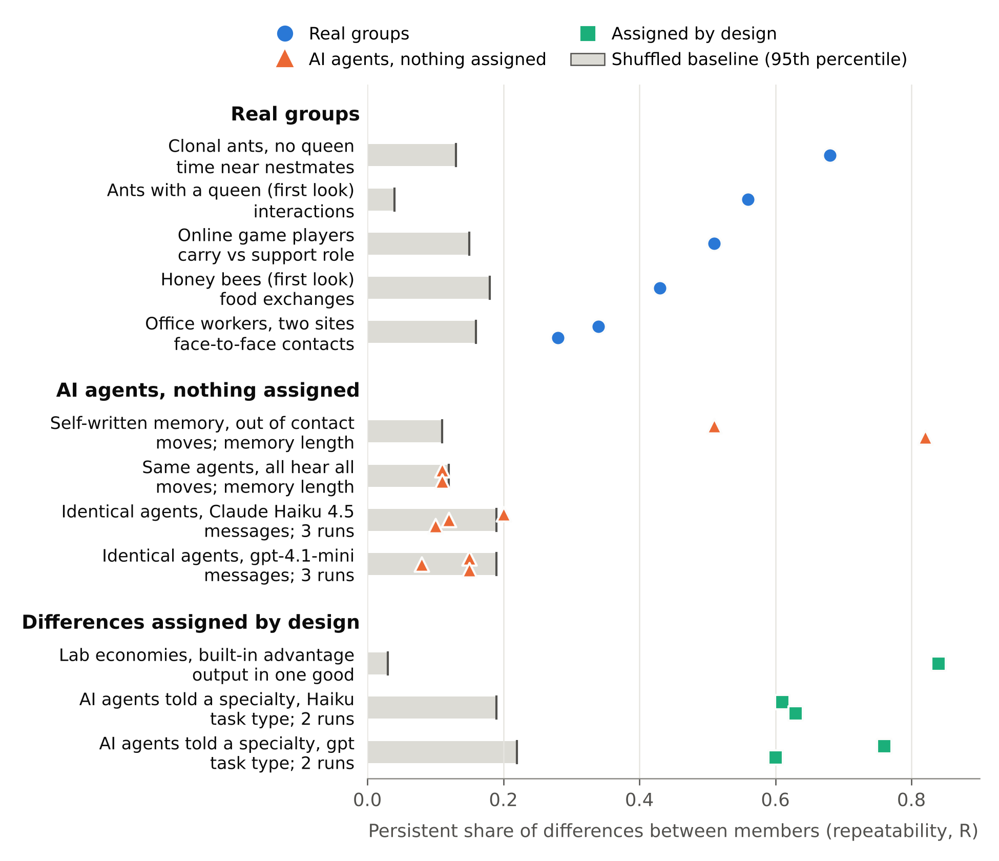

# A differentiation benchmark for synthetic organizations

Research artifact for a Stage 1 proposal to the *Organization Science* special issue
"AI-Enabled Frontiers in Organizational Science". Authors are withheld for review.

**The question.** When a hub, a leader or a specialist appears among AI agents working
together, did the agents generate that structure, or did the researcher's prompt inject it?
This repository gives one test that answers that for any multi-agent simulation. It scores
whether differences between members persist over time against a shuffled baseline, and
checks the result against real groups.



*Figure 1. Each group's persistent share of differences between members (markers) against
its shuffled baseline (grey bar, 95th percentile of a label-permutation null). Rows record
different behaviors, so read each value against its own baseline.*

## What is here

| Part | Where | What it does |
|---|---|---|
| The yardstick | `code/diffenv/measures.py` | `differentiation()` takes any long table (group, window, member, value) and returns repeatability R, split-half reliability and a label-permutation null (200 draws). It also returns task entropy against a type-shuffle null, favoured-type R and partner consistency. |
| The synthetic organization | `code/diffenv/env.py`, `policies.py`, `run.py` | Nine agents share a queue; each item is revealed to one agent and finished only when a second agent also works on it, so the group must communicate. 100 rounds, 10-round windows. |
| Controls | `policies.py` | C0 rule agents (must sit at the null), C0+ rule agents with built-in differences (must be detected), C2 agents told a specialty (LLM positive control). |
| Artifact checks | `run.py` flags | Randomized item and recipient order (default), `--alias` per-viewer randomized names (a Latin square), and correction for opportunity (who received work). Each was added after it caught a false positive in our own runs. |
| Real-group reference values | `code/diffenv/run_substrates.py`, `substrates.py`, `run_external.py`, `external.py` | The same function, unchanged, on clonal ants, ants with a queen, honey bees, two offices, online game players and lab economies. |
| Every run we report | `code/diffenv_results/` | One JSON specimen per run (full event log, prompts, every raw model reply, tokens, cost) plus a JSONL journal of every API call. |
| Figure | `code/figures/` | Figure 1 as PDF, PNG and SVG, and the script that draws it. |

## Quick start (no API key, about two minutes)

Python 3.9 or later.

```bash
pip install -r requirements.txt
cd code
python3 -m diffenv.test_measures      # fixtures with known answers for the yardstick
python3 -m diffenv.test_alias         # the randomized-name control works as designed
python3 -m diffenv.test_pipeline      # mock end-to-end run, budget caps, key handling
python3 -m diffenv.run --condition c0 --seeds 0 1 2 --visibility private    # rule-agent floor
python3 -m diffenv.report diffenv_results/final/specimens                   # re-score stored runs
```

## Reproducing the synthetic results

API keys go in `keys.env` at the repository root (`ANTHROPIC_API_KEY=...`,
`OPENAI_API_KEY=...`). The file is git-ignored and its contents are never printed or logged.
Each run is 9 agents x 100 rounds = 900 short calls. Hard caps on calls and cost are checked
before every call, and an interrupted run resumes from its journal without repeating any
call.

```bash
cd code
# identical agents, names randomized (the main finding); about $0.43 per run on Haiku 4.5
python3 -m diffenv.run --condition c1 --visibility private --alias \
  --backend anthropic --model claude-haiku-4-5 --seeds 0 1 2 \
  --full-run --max-calls 2700 --max-cost 2.00 \
  --out results/specimens --journal-dir results/journal
# the same on gpt-4.1-mini (about $0.16 per run)
python3 -m diffenv.run --condition c1 --visibility private --alias \
  --backend openai --model gpt-4.1-mini --seeds 0 1 2 \
  --full-run --max-calls 2700 --max-cost 1.00 \
  --out results/specimens --journal-dir results/journal
# other conditions: --condition c2 (assigned specialty), c3 (assigned personality),
# --competence (hidden skill differences), --exit (option to leave)
python3 -m diffenv.report results/specimens
```

Stored runs, by folder:

| Folder | Runs |
|---|---|
| `diffenv_results/final/` | C0, C0+, C1, C1+competence, C1+exit, C2, C3 on both models, fixed names (30 September 2026) |
| `diffenv_results/alias_rerun/` | C1 and C1+exit on gpt-4.1-mini with randomized names; `STATUS.md` compares them with fixed names |
| `diffenv_results/gaps_2026-10-16/` | C1 on Haiku 4.5 with randomized names; a second C2 run on each model |
| `diffenv_results/substrates_*` | Real-group scores (ants, offices, first looks at queen colonies and bees) |
| `diffenv_results/external_2026-10-06/` | Online game players, lab economies, and a published LLM-agent study |

Read communication measures from fixed-name runs with care: on gpt-4.1-mini the model's
preference for the label "A1" produces a hub that disappears once names are randomized.
That is why `--alias` exists. Work and task-choice measures are unaffected.

## Reproducing the real-group values

The raw data are not redistributed here. Each comes from its original deposit (see
`DATA.md` for sources and licences).

```bash
cd code
python3 fetch_data.py --tier core --dest <folder>          # bees, queen-colony ants, office 2013
python3 fetch_data.py --only sociopatterns_workplace_2015 alciatore_2021 --dest <folder>
python3 -m diffenv.run_substrates --ants <...>/IndividualBehavioursData.xlsx \
  --ant-networks <...>/Network_1mmDist6h \
  --invs2013 <...>/tij_InVS.dat <...>/workplace_InVS_metadata.txt \
  --invs2015 <...>/workplace_InVS15_tij.dat.gz <...>/workplace_InVS15_metadata.txt \
  --out results/substrates
PYTHONPATH=. python3 diffenv_results/substrates_2026-09-30b/first_look_other_colonies.py <raw data folder>
```

Online game players and lab economies (`run_external` reads `../data/`):

```bash
python3 ../data/dota_sample/get_dota_sample.py                  # OpenDota public dump, first 3 GB
python3 ../get_kimbrough_data.py <openICPSR-113239.zip> --project ..   # download the zip from openICPSR first
python3 -m diffenv.run_external --skip takata
```

The Alciatore deposit is about 4.9 GB. Dryad may ask for a free sign-in; `fetch_data.py`
explains how.

## Data not included

The logs of Takata et al. (2024) were shared with us by the authors for this analysis only
and are not redistributed. The scoring code (`external.takata_tables`) and our scores
(`diffenv_results/external_2026-10-06/`) are included. The logs are available from the
original authors on request.

## Limitations, stated up front

- The synthetic results come from two small models (Claude Haiku 4.5, gpt-4.1-mini) whose
  agents see only their last five actions. Stronger models or memory may differentiate.
- The reference groups are measured on different behaviors and time scales. Compare each
  value with its own baseline, not across rows.
- The relational diagnostic (stable partnerships) still follows name labels under
  randomized names and needs a further control.
- `code/PIPELINE_NOTES.md` is the working log of the real-data pipeline. It is kept for
  auditability, and some of it predates the current design.

## License

Code: MIT (see `LICENSE`). Stored model outputs and derived scores: CC BY 4.0. The data
behind the real-group values keep their original licences (`DATA.md`).
